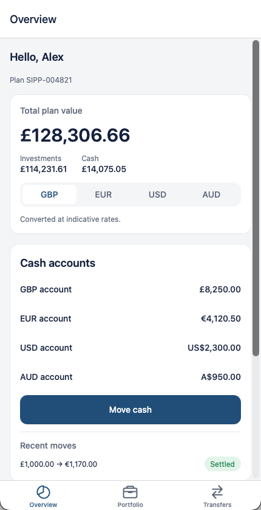
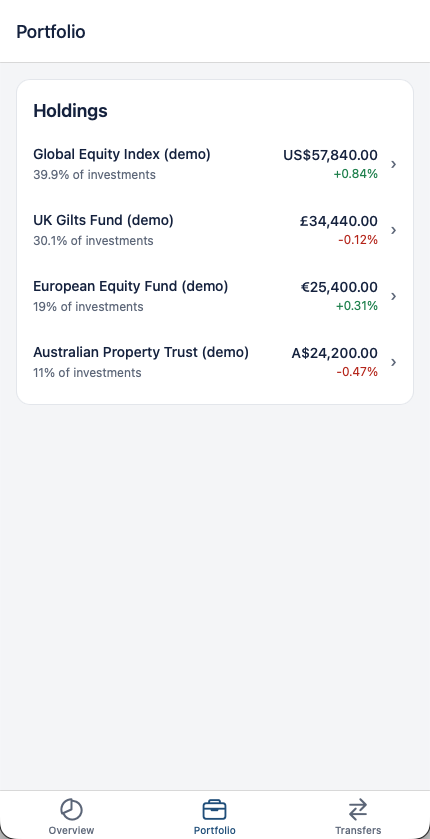
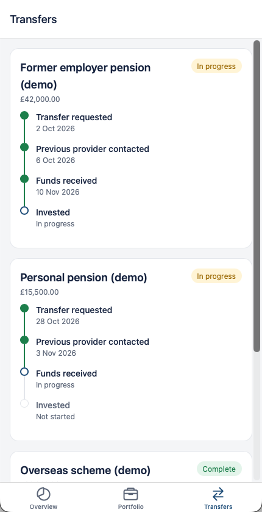

# SIPP client sample

A small Expo app for someone checking their multi-currency SIPP: total value, cash accounts, portfolio, pension transfer tracking, and one write, moving cash between currency accounts. It talks to a small Node REST API in the same repo.

It is a working example of how I would start a new client app on top of an existing REST backend. Everything in it is sample data.

<p>
  
  
  
</p>

How I build and why it looks the way it does: **[docs/approach.md](docs/approach.md)**.

## Run it

Node 22.18 or later. Two terminals:

```bash
cd server && npm install && npm run dev
```

```bash
cd app && npm install && npm run go
```

Scan the QR code with Expo Go (SDK 58) on a phone on the same Wi-Fi, or press `w` for the web build. The app finds the API on the machine running Metro. To point it somewhere else, copy `app/.env.example` to `app/.env` and set `EXPO_PUBLIC_API_URL`.

Checks:

```bash
cd app && npm run typecheck && npm run lint && npm test
cd server && npm test
```

## What is real and what is not

- **Real:** HTTP against a REST API, loading, error and empty states on every screen, validation on both client and server, the cash move round trip with an optimistic pending state and rollback, polling until a pending move settles.
- **Not real:** the data, the exchange rates, and auth. The app sends a fixed demo bearer token and client id, and the server is a local stub with no real security.

## Layout

```
app/src/
  app/          routes only (Expo Router); each file renders a screen
  screens/      one folder per screen: Screen.tsx, hooks/ (the view model), helpers/, components/
  components/
    atoms/      Text, Button, Card, Screen, Skeleton, TextInput, Pressable
    molecules/  Money, StatusChip, ListRow, EmptyState, ErrorState, CurrencyToggle
  hooks/        shared hooks (useRefresh for pull to refresh)
  data/         api.ts, queryKeys.ts, cache.ts, queryClient.ts, one file per resource
  store/        Zustand: session and preferences slices
  theme/        colors.json, read by Tailwind and by code
  utils/        money and date formatting
server/src/     Express routes, seed data, in-memory store
```

## Decisions in brief

- **Expo with Expo Router.** One codebase for iOS and Android, file-based routes, OTA updates later. It runs in Expo Go, so no native build is needed to try it.
- **React Query for server state, Zustand for client state.** They never overlap. Zustand only holds the session and the display currency.
- **A view model is a set of small hooks.** Each screen has `useXScreen`, built from sibling hooks split by concern. Screens only render. Pure logic lives in plain helpers so it tests without a renderer.
- **The atoms layer is enforced.** ESLint blocks `Text`, `TextInput` and `Pressable` from `react-native` outside `components/atoms`. Colours come from one JSON token file.
- **Money moves are pending until the server says otherwise.** The UI shows the move straight away as pending, rolls back if the API refuses it, and only calls it settled when the server does.
- **Tests sit at the seams.** Money maths, move validation, the transfer timeline, the optimistic update and rollback, and the server's move rules.
